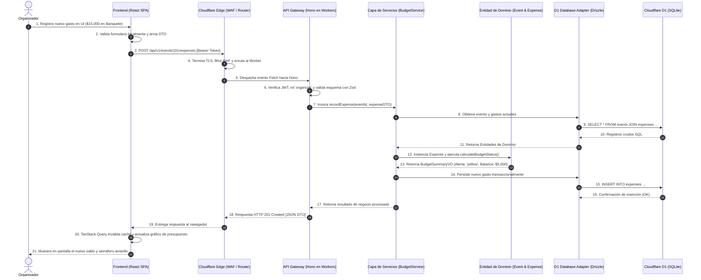
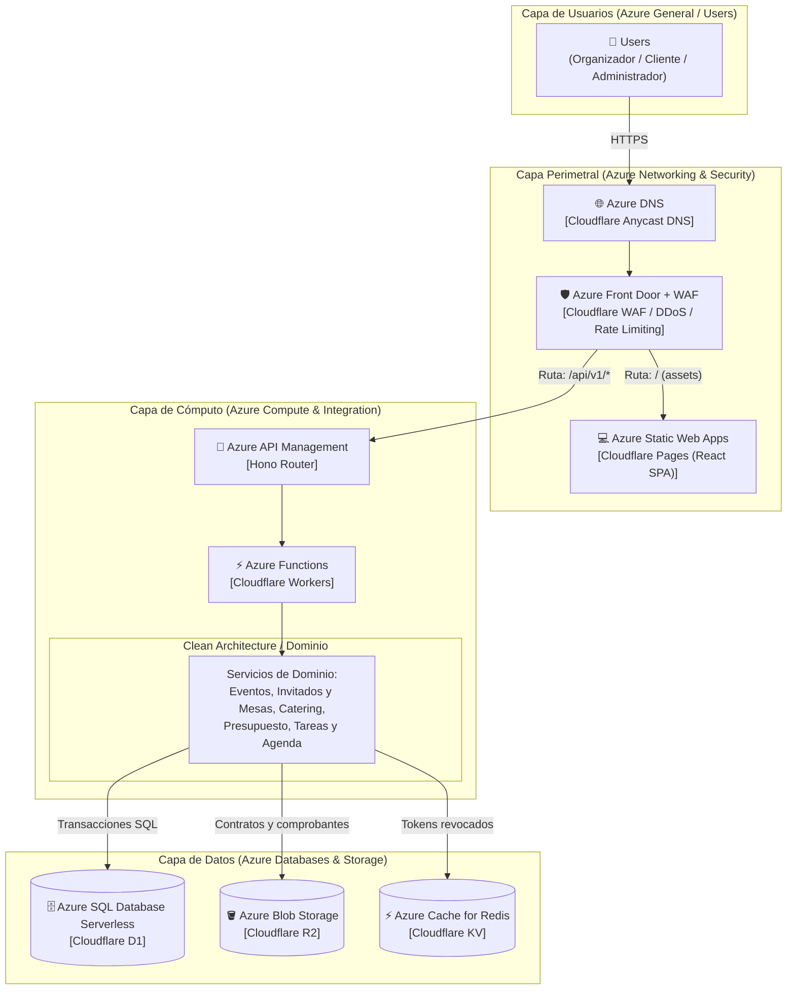

# Arquitectura Lógica del Software — Planora

**Ecosistema Cloud:** Cloudflare Native Edge Ecosystem  
**Patrón Arquitectónico:** Clean Architecture (Puertos y Adaptadores / Arquitectura Hexagonal) adaptada a Edge Runtimes  
**Paradigma:** Monolito Modular en el Borde (*Modular Edge Monolith*), TypeScript End-to-End  
**Principios de Diseño:** Inversión de Dependencias (DIP), Responsabilidad Única (SRP), Separación de Preocupaciones (SoC), Cero Estado en Servidor (*Stateless Compute*)  

---

## 1. Fundamentos y Visión General de la Arquitectura Lógica

La arquitectura lógica de **Planora** ha sido diseñada para desacoplar por completo la interfaz de usuario, la exposición de APIs, la lógica de negocio pura y los mecanismos de persistencia en la nube. 

A diferencia de modelos arquitectónicos convencionales donde la lógica de negocio se mezcla dentro de los controladores de rutas o en consultas directas a la base de datos (*Smart UI* o *Anemic Domain Model*), **Planora** implementa una **Arquitectura Limpia en Capas (Clean Architecture)**:

```text
[ Capa 1: Usuario ]
        ↓
[ Capa 2: Frontend (React SPA) ]
        ↓
[ Capa 3: Cloudflare Edge (DNS / WAF / Router) ]
        ↓
[ Capa 4: API Gateway & Controladores (Hono en Workers) ]
        ↓
[ Capa 5: Servicios de Aplicación & Dominio (Lógica de Negocio) ]
        ↓
[ Capa 6: Persistencia y Almacenamiento (D1, R2, KV via Puertos/Adaptadores) ]
```

### Regla de Dependencia Unidireccional
Las dependencias fluyen estrictamente **hacia adentro**:
- Las entidades del dominio no conocen la existencia de la base de datos (Cloudflare D1), ni del almacenamiento de archivos (Cloudflare R2), ni de HTTP (Hono).
- La capa de aplicación opera sobre **contratos/interfaces (Puertos)**.
- La infraestructura concreta de Cloudflare implementa dichos puertos mediante **Adaptadores**, inyectados en tiempo de ejecución a través de los *Bindings* nativos de Cloudflare Workers.

---

## 2. Diagrama de Arquitectura Lógica Completa (Mermaid)

El siguiente diagrama detalla la jerarquía completa de capas lógicas, los módulos funcionales internos de cada nivel y los límites de responsabilidad:

```mermaid
%%{init: {
  'theme': 'base',
  'themeVariables': {
    'primaryColor': '#ffffff',
    'primaryBorderColor': '#1e293b',
    'primaryTextColor': '#0f172a',
    'lineColor': '#334155',
    'secondaryColor': '#ffffff',
    'tertiaryColor': '#ffffff',
    'mainBkg': '#ffffff',
    'nodeBorder': '#1e293b',
    'nodeTextColor': '#0f172a',
    'clusterBkg': '#ffffff',
    'clusterBorder': '#64748b',
    'clusterTextColor': '#0f172a',
    'titleColor': '#0f172a',
    'edgeLabelBackground': '#ffffff'
  }
}}%%
flowchart TD
    %% ========================================================
    %% CAPA 1: USUARIO
    %% ========================================================
    subgraph Layer1["1. CAPA DE USUARIOS (ACTORES)"]
        OrganizerUser["Organizador de Eventos\n(Wedding Planner / Coordinador Corporativo)"]
        ClientUser["Cliente Anfitrión\n(Novios / Empresa / Festejado)"]
        AdminUser["Administrador de Plataforma\n(Supervisión y Auditoría)"]
    end

    %% ========================================================
    %% CAPA 2: FRONTEND (CLIENTE SPA)
    %% ========================================================
    subgraph Layer2["2. CAPA FRONTEND (CLIENT-SIDE REACT SPA)"]
        subgraph UIViews["Vistas e Interfaz (UI Components)"]
            DashboardView["Dashboard & KPIs View"]
            EventsView["Event Lifecycle & Detail View"]
            BudgetView["Budget & Expense Reconciliation View"]
            ClientsView["Clients & Host Portal View"]
            GuestsView["Guest List, Tables & Catering View"]
            VendorsView["Vendors & Services Catalog View"]
            TasksAgendaView["Tasks Kanban & Agenda Timeline View"]
        end

        subgraph ClientCore["Gestor de Estado y Comunicación"]
            Router["React Router v6\n(Auth Guards & Role RBAC)"]
            QueryCache["TanStack Query (React Query)\n(Server-State Cache & Deduplication)"]
            UIState["Zustand Store\n(Auth Context, Token & Active Session)"]
            APIClient["HTTP Client / Fetch Wrapper\n(JWT Interceptor & Error Boundary)"]
        end

        UIViews --> Router
        Router --> QueryCache
        QueryCache --> UIState
        UIState --> APIClient
    end

    %% ========================================================
    %% CAPA 3: CLOUDFLARE EDGE NETWORK (PERÍMETRO Y ENRUTAMIENTO)
    %% ========================================================
    subgraph Layer3["3. CAPA CLOUDFLARE EDGE (PERÍMETRO GLOBAL ANYCAST)"]
        EdgeDNS["Cloudflare Anycast DNS\n(Resolución global < 10ms)"]
        EdgeSecurity["Cloudflare WAF & DDoS Shield\n(TLS 1.3 / HTTP/3 / Rate Limiting Rule)"]
        EdgeRouter{"Cloudflare Edge Dispatcher\n(Enrutador de Rutas)"}
        
        PagesHost["Cloudflare Pages Host\n(Entrega de Bundles Estáticos SPA)"]
        WorkersRuntime["Cloudflare Workers Runtime\n(V8 Isolates / Cero Arranque en Frío)"]

        EdgeDNS --> EdgeSecurity --> EdgeRouter
        EdgeRouter -->|"Ruta: / o /assets/*"| PagesHost
        EdgeRouter -->|"Ruta: /api/v1/*"| WorkersRuntime
    end

    %% ========================================================
    %% CAPA 4: API GATEWAY Y CONTROLADORES (HONO EN WORKERS)
    %% ========================================================
    subgraph Layer4["4. CAPA DE ENTRADA / API (HONO REST API GATEWAY)"]
        HonoRouter["Hono Framework Router\n(RegExpRouter de Alto Rendimiento)"]

        subgraph MiddlewarePipeline["Pipeline de Middlewares"]
            CorsMw["CORS & Security Headers Middleware"]
            AuthMw["JWT Verification Middleware\n(Web Crypto API)"]
            RbacMw["Role-Based Access Control Guard\n(admin, organizer, client)"]
            ZodMw["Zod Input Validation Middleware\n(Request Body / Params DTOs)"]
            ErrorMw["Global Error Handler & Logger"]
        end

        subgraph Controllers["Controladores REST (Adapters Primarios)"]
            AuthController["AuthController\n(/api/v1/auth)"]
            ClientController["ClientController\n(/api/v1/clients)"]
            EventController["EventController\n(/api/v1/events)"]
            BudgetController["BudgetController\n(/api/v1/events/:id/budget, /expenses)"]
            GuestController["GuestController\n(/api/v1/events/:id/guests, /tables, /catering-report)"]
            VendorController["VendorController\n(/api/v1/vendors, /services)"]
            TaskController["TaskController\n(/api/v1/tasks)"]
            AgendaController["AgendaController\n(/api/v1/agenda)"]
            DashboardController["DashboardController\n(/api/v1/dashboard)"]
        end

        WorkersRuntime --> HonoRouter
        HonoRouter --> CorsMw --> AuthMw --> RbacMw --> ZodMw --> ErrorMw
        ZodMw --> Controllers
    end

    %% ========================================================
    %% CAPA 5: SERVICIOS Y DOMINIO (LÓGICA DE NEGOCIO PURA)
    %% ========================================================
    subgraph Layer5["5. CAPA DE SERVICIOS Y DOMINIO (LÓGICA DE NEGOCIO)"]
        subgraph ApplicationServices["Servicios de Aplicación (Casos de Uso)"]
            AuthService["Auth & Session Service\n(Login, Token Sign, Logout)"]
            ClientService["Client Service\n(CRUD, LinkUserAccount, HistorySummary)"]
            EventService["Event Lifecycle Service\n(ConfirmEvent, CancelEvent, Clone)"]
            BudgetService["Budget Engine Service\n(CalculateStatus, OverrunAlert, Reconcile)"]
            GuestService["Guest & RSVP Service\n(RegisterRsvp, AssignTable, DietaryProfile)"]
            CateringService["Catering Report Service\n(GenerateCateringReport)"]
            VendorService["Vendor & Contract Service\n(ContractService, SignDocument)"]
            TaskService["Task Operation Service\n(CompleteTask, CalculateProgress)"]
            AgendaService["Timeline Schedule Service\n(ReorderTimeline, DetectConflicts)"]
            DashboardService["Dashboard Aggregator Service\n(CalculateKPIs, EventDeepSummary)"]
        end

        subgraph DomainCore["Núcleo del Dominio (Pure Domain Core)"]
            Entities["Entidades de Negocio:\nUser, Client, Event, Guest, EventTable,\nVendor, Service, EventService, Expense, Task, AgendaItem"]
            ValueObjects["Value Objects Inmutables:\nBudgetSummaryVO, CateringReportVO, TimeIntervalVO"]
            DomainRules["Reglas de Invarianza:\nValidación de Fechas, Aforo Máximo de Mesas, Límite de Gasto"]
        end

        subgraph Ports["Puertos del Dominio (Interfaces Abstraídas)"]
            IRepoUsers["IUserRepository / IClientRepository"]
            IRepoEvents["IEventRepository"]
            IRepoBudget["IExpenseRepository"]
            IRepoGuests["IGuestRepository / IEventTableRepository"]
            IRepoVendors["IVendorRepository / IContractRepository"]
            IRepoTasks["ITaskRepository"]
            IRepoAgenda["IAgendaRepository"]
            IFileStorage["IFileStoragePort"]
            ICachePort["ICacheSessionPort"]
        end

        Controllers --> ApplicationServices
        ApplicationServices --> DomainCore
        ApplicationServices --> Ports
    end

    %% ========================================================
    %% CAPA 6: PERSISTENCIA Y ALMACENAMIENTO (ADAPTADORES DE INFRAESTRUCTURA)
    %% ========================================================
    subgraph Layer6["6. CAPA DE PERSISTENCIA Y ALMACENAMIENTO (CLOUDFLARE ADAPTERS)"]
        subgraph InfrastructureAdapters["Adaptadores Secundarios (Infraestructura)"]
            DrizzleAdapter["Drizzle ORM Adapter\n(Implementa IRepositories mediante SQL Tipado)"]
            R2StorageAdapter["Cloudflare R2 Adapter\n(Implementa IFileStoragePort para PDFs y Comprobantes)"]
            KVStorageAdapter["Cloudflare KV Adapter\n(Implementa ICacheSessionPort para Blacklist de JWT)"]
        end

        subgraph CloudflareResources["Recursos Persistentes de Cloudflare"]
            D1Engine[("Cloudflare D1 Database\nMotor SQLite Transaccional Serverless\nBinding: env.DB")]
            R2Engine[("Cloudflare R2 Object Storage\nAlmacén de Objetos S3 Sin Costos de Egress\nBinding: env.STORAGE")]
            KVEngine[("Cloudflare KV Store\nAlmacén Clave-Valor Distribuido en Memoria\nBinding: env.KV_CACHE")]
        end

        IRepoUsers & IRepoEvents & IRepoBudget & IRepoGuests & IRepoVendors & IRepoTasks & IRepoAgenda --> DrizzleAdapter
        IFileStorage --> R2StorageAdapter
        ICachePort --> KVStorageAdapter

        DrizzleAdapter -->|"Consultas SQL Transaccionales"| D1Engine
        R2StorageAdapter -->|"PutObject / GetSignedUrl"| R2Engine
        KVStorageAdapter -->|"Get / Put con TTL"| KVEngine
    end

    %% ========================================================
    %% RELACIONES ENTRE CAPAS SUPERIORES
    %% ========================================================
    OrganizerUser & ClientUser & AdminUser -->|"Interactúa con UI"| UIViews
    APIClient -->|"Petición HTTPS / JSON"| EdgeDNS
    PagesHost -.->|"Descarga inicial de Assets"| UIViews
```



---

## 3. Desglose Detallado de Capas Lógicas y Responsabilidades

### 3.1 Capa 1: Usuario y Actores
Representa a los consumidores directos de la solución. Cada actor cuenta con un contexto delimitado (*Bounded Context*) dentro del sistema:
- **Organizador:** Ejecuta casos de uso administrativos, financieros, contractuales y logísticos completos.
- **Cliente:** Consume vistas de solo lectura de su evento (avance, resumen de presupuesto y cronograma) y puede confirmar o actualizar su lista de invitados. No modifica gastos, contratos ni proveedores.
- **Administrador:** Acceso a métricas de auditoría global del sistema y supervisión técnica.

---

### 3.2 Capa 2: Frontend (Client-Side Presentation Layer)
Construida como una Single Page Application (SPA) sobre React 18 y TypeScript, optimizada para ejecutarse en el navegador del usuario:
1. **Componentes Visuales (UI Views):** Interfaces modulares construidas con Tailwind CSS que representan los módulos del negocio (Dashboard, Clientes, Eventos, Finanzas, Invitados y Mesas con Reporte de Catering, Proveedores, Tareas y Cronograma).
2. **React Router v6:** Controla la navegación en el cliente, evaluando guardias de autenticación (*AuthGuards*) y permisos según el rol almacenado en el token.
3. **TanStack Query (React Query):** Administra el estado asíncrono del servidor en el cliente. Proporciona caché en memoria, deduplicación de peticiones, reintentos automáticos y actualización optimista de datos en pantalla.
4. **Zustand Store:** Almacén de estado global ligero para datos de sesión efímeros (usuario activo, token JWT, preferencias visuales).
5. **Cliente HTTP Tipado:** Capa de abstracción sobre la Fetch API nativa que inyecta automáticamente el encabezado `Authorization: Bearer <token>`, intercepta respuestas 401 para expiración de sesión y deserializa los DTOs fuertemente tipados generados por la API.

---

### 3.3 Capa 3: Perímetro Cloudflare Edge (Red y Distribución)
La infraestructura distribuida de Cloudflare actúa como la primera línea de procesamiento y enrutamiento en el borde:
1. **Anycast DNS:** Resuelve la dirección IP del usuario hacia el centro de datos de Cloudflare más cercano físicamente (<10 ms).
2. **WAF & DDoS Shield:** Filtra tráfico malicioso, mitiga ataques distribuidos de denegación de servicio e implementa terminación TLS 1.3 con certificados automáticos.
   - **Rate Limiting de Workers:** el binding `ratelimits` (`AUTH_RATE_LIMITER`, declarado en `wrangler.toml`) limita a 10 peticiones en 10 s por IP las rutas `/api/v1/auth/*` y responde **429** con `Retry-After: 10`, frenando ataques de fuerza bruta contra el login. Se usa el limitador nativo de Workers porque las reglas de rate limiting del WAF solo aplican a zonas con dominio propio (no a `*.workers.dev`), y KV no es adecuado para contadores por su consistencia eventual.
3. **Cloudflare Edge Dispatcher:**
   - Si la ruta solicitada corresponde a la aplicación web (`/`, `/assets/*`, `/favicon.ico`), sirve los archivos precompilados en caché global desde **Cloudflare Pages**.
   - Si la ruta comienza con `/api/v1/*`, despacha la solicitud directamente hacia el runtime de **Cloudflare Workers**.

---

### 3.4 Capa 4: API Gateway y Controladores (Cloudflare Workers + Hono)
El backend corre en Cloudflare Workers utilizando el microframework **Hono** para ofrecer enrutamiento ultrarrápido y seguro:
1. **Pipeline de Middlewares:**
   - `CorsMiddleware`: Restringe orígenes cruzados permitidos y cabeceras seguras.
   - `AuthMiddleware`: Extrae el token JWT, valida su firma criptográfica con Web Crypto API y consulta Cloudflare KV para garantizar que no esté revocado.
   - `RbacGuard`: Valida que el rol del usuario coincida con la política requerida por el endpoint (`admin`, `organizer`, `client`).
   - `ZodValidationMiddleware`: Parsea y sanitiza la carga útil entrante (*body*, *query params*); si los datos no cumplen el contrato DTO, rechaza la solicitud de inmediato con HTTP 400 antes de tocar la lógica de negocio.
   - `GlobalErrorHandler`: Atrapa excepciones de dominio y las traduce a respuestas JSON estandarizadas (código de error, mensaje descriptivo, timestamp).
2. **Controladores REST:** Mapean las rutas HTTP a las invocaciones de los Servicios de Aplicación correspondientes. No contienen lógica de negocio; solo transforman DTOs de entrada y devuelven respuestas HTTP estructuradas.

---

### 3.5 Capa 5: Servicios de Aplicación y Núcleo del Dominio (Business Logic Layer)
Esta capa es el corazón intelectual de **Planora**. Es código TypeScript puro, sin dependencias de frameworks web ni de controladores HTTP:
1. **Servicios de Aplicación (Casos de Uso):**
   - Orquestan el flujo de datos.
   - Ejemplo: `BudgetService.recordExpense()` recibe el DTO, instancia la entidad `Expense`, invoca el método de dominio `isOverdue()`, lo persiste mediante `IExpenseRepository`, recalcula el balance mediante `calculateBudgetStatus()` y emite una alerta si se detecta sobrecosto.
2. **Entidades del Dominio y Value Objects:**
   - Modela las reglas fundamentales de la empresa:
     - `Event`: controla el ciclo de vida y la coherencia de estados.
     - `Guest` y `EventTable`: aplican las reglas de aforo de mesas y el perfil gastronómico (menú y alergias críticas).
     - `CateringReportVO`: consolidado inmutable de platillos por menú, platillos por mesa y alertas de alergias críticas.
     - `BudgetSummaryVO`: objeto de valor inmutable que encapsula `initialBudget`, `totalSpent`, `remainingBalance` y `statusAlert`.
3. **Puertos del Dominio (Ports):**
   - Interfaces TypeScript (`IEventRepository`, `IExpenseRepository`, `IFileStoragePort`, `ICacheSessionPort`) que declaran qué operaciones necesita el dominio sin saber cómo están implementadas técnicamente.

---

### 3.6 Capa 6: Persistencia y Almacenamiento (Adaptadores Cloudflare)
Implementa los Puertos del dominio conectándose a los recursos físicos de Cloudflare:
1. **Drizzle ORM Adapter (para Cloudflare D1):**
   - Implementa los repositorios relacionales.
   - Ejecuta consultas SQL seguras mediante el binding `env.DB`.
   - Garantiza transacciones ACID para operaciones críticas como cancelaciones en cascada o contrataciones.
2. **Cloudflare R2 Storage Adapter:**
   - Implementa `IFileStoragePort`.
   - Interactúa con el bucket `planora-assets-prod` mediante el binding `env.STORAGE` para almacenar contratos PDF y comprobantes digitales sin costos de salida (*zero egress fees*).
3. **Cloudflare KV Session Adapter:**
   - Implementa `ICacheSessionPort`.
   - Registra identificadores de tokens revocados con expiración TTL automática mediante el binding `env.KV_CACHE`.

---

## 4. Flujo Lógico de Procesamiento de Peticiones (End-to-End)

A continuación se ilustra la secuencia exacta en que viajan los datos a través de las 6 capas cuando un usuario ejecuta una acción crítica de negocio (por ejemplo, registrar un gasto y conciliar el presupuesto):



## 5. Homologación con Microsoft Azure

La solución se ejecuta de forma nativa en Cloudflare. Para leerla con una notación estándar de la industria, cada componente se relaciona con su servicio equivalente en la biblioteca oficial de [íconos de arquitectura de Azure](https://learn.microsoft.com/es-es/azure/architecture/icons/):

| Componente Lógico | Recurso en Cloudflare (ejecución real) | Equivalente / Ícono Azure | Función |
|---|---|---|---|
| Usuarios / Actores | Navegadores web y móviles | General / Users | Organizadores, clientes y administradores. |
| Frontend SPA | Cloudflare Pages | Azure Static Web Apps | Aloja y distribuye el bundle de React + Vite. |
| DNS y enrutamiento global | Cloudflare Anycast DNS | Azure DNS | Resolución hacia el nodo de borde más cercano. |
| Seguridad perimetral | Cloudflare DDoS y Rate Limiting de Workers | Azure Front Door + Azure Web Application Firewall | Filtrado de ataques, mitigación DDoS, rate limiting, TLS 1.3 y enrutamiento `/` vs `/api/v1/*`. |
| API Gateway | Hono Router (en Workers) | Azure API Management | Rutas `/api/v1/*`, CORS, autenticación y validación Zod. |
| Cómputo serverless | Cloudflare Workers | Azure Functions | Ejecuta controladores y servicios de dominio. |
| Base de datos relacional | Cloudflare D1 (SQLite) | Azure SQL Database Serverless | Datos transaccionales ACID. |
| Almacenamiento de objetos | Cloudflare R2 | Azure Blob Storage | Contratos PDF y comprobantes de pago. |
| Caché clave-valor | Cloudflare KV | Azure Cache for Redis | Revocación de JWT (logout). |

### 5.1 Diagrama de Arquitectura con Notación Azure

El siguiente diagrama representa la misma arquitectura con la nomenclatura de Azure; entre corchetes se indica el recurso de Cloudflare que realmente lo ejecuta.



## 6. Justificación de Decisiones de Arquitectura Lógica

1. **¿Por qué Puertos y Adaptadores (Clean Architecture) en un Edge Monolith?**  
   Permite que la lógica de negocio (fórmulas de presupuesto, cálculos de aforo, transiciones de eventos) sea **100% testeable de forma aislada con Vitest**, sin necesidad de conectarse a bases de datos en la nube ni simular la red.
2. **¿Por qué Hono en lugar de Express o NestJS?**  
   Express y NestJS fueron concebidos para servidores Node.js permanentes con sockets TCP tradicionales y ocupan más de 30 MB en memoria. Hono fue diseñado específicamente para la API de Web Standards (`Request`/`Response`) de los V8 Isolates de Cloudflare Workers, pesa menos de 15 KB y compila con latencia de ejecución prácticamente nula.
3. **¿Por qué Bindings de Cloudflare en lugar de conexiones TCP estándar?**  
   Cloudflare Workers inyecta los recursos (D1, R2, KV) en el contexto de ejecución del proceso (`env`). Esto elimina la sobrecarga de negociación de conexiones TCP (*TCP handshake/SSL handshake*), evitando cuellos de botella y fugas de contraseñas de conexión.

