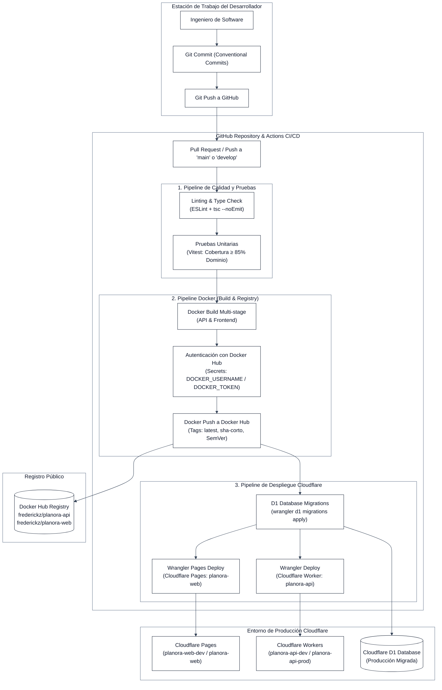

# Estrategia y Flujo de Despliegue Continuo (CI/CD) — Planora

**Herramienta de Orquestación:** GitHub Actions  
**Registro de Contenedores:** Docker Hub  
**Plataforma de Despliegue:** Cloudflare (Workers & Pages)  
**Herramienta de Despliegue en el Borde:** Cloudflare Wrangler CLI  

---

## 1. Aclaración Fundamental sobre la Arquitectura de Despliegue

> [!IMPORTANT]
> **Diferenciación Técnica Clave:**  
> **Cloudflare Workers NO ejecuta contenedores Docker en tiempo de ejecución.**  
> Cloudflare Workers opera sobre **V8 Isolates** nativos distribuidos en el Edge, lo que le permite iniciar en 0 milisegundos sin la sobrecarga de un sistema operativo contenedorizado.
> 
> **¿Por qué se utiliza Docker y Docker Hub en este proyecto?**
> 1. **Entorno de Compilación y Pruebas 100% Reproducible:** Docker aísla las dependencias del sistema operativo, garantizando que los tests de Vitest y las compilaciones de TypeScript se ejecuten exactamente igual en la máquina del desarrollador y en los agentes de GitHub Actions.
> 2. **Cumplimiento de Estándares de Infraestructura de la Asignatura:** Satisface los requisitos de entrega de la materia *Infraestructura para el Desarrollo Continuo*, empaquetando los artefactos del backend y frontend como imágenes OCI versionadas y publicadas en Docker Hub.
> 3. **Portabilidad y Despliegues Alternativos:** Facilita la ejecución de la plataforma en entornos on-premise, servidores locales de evaluación docente o nubes alternativas en caso de requerirse.

---

## 2. Diagrama de Pipeline de Deployment (Mermaid)

---

## 3. Especificación de los Pipelines de GitHub Actions

El CI/CD está dividido en dos workflows, uno por componente. Ambos se disparan con `push` y `pull_request` hacia `develop` y `main`.

### [`backend.yml`](../.github/workflows/backend.yml) — BackEnd CI/CD
| Job | Cuándo corre | Qué hace |
|---|---|---|
| **BackEnd - Build y Pruebas (UAT)** | Siempre (PR y push) | `npm ci`, lint, typecheck (src, tests y scripts), build, Vitest con reporte JUnit publicado como **UAT Report** y cobertura con umbrales (dominio ≥ 85%). |
| **BackEnd - Docker Hub** | Push a `develop` / `main` | Construye `docker/Dockerfile.api` y publica `planora-api:{latest\|dev}` y `:sha-<commit>`. |
| **BackEnd - Ambiente Dev** | Push a `develop` / `main` (Environment `dev`) | Sustituye `D1_DATABASE_ID`, aplica `wrangler d1 migrations apply DB --remote`, despliega el Worker `planora-api-dev` y sube los secretos (`JWT_SECRET`, `SENTRY_DSN`, `ALLOWED_ORIGINS`). |
| **BackEnd - Ambiente Prod** | Solo `main`, tras Dev y Docker Hub (Environment `production` con aprobación manual) | Mismos pasos contra `planora-d1-prod` y `planora-api-prod`. |

### [`frontend.yml`](../.github/workflows/frontend.yml) — Frontend CI/CD
| Job | Cuándo corre | Qué hace |
|---|---|---|
| **Frontend - Build y Pruebas** | Siempre | `npm ci`, lint, typecheck, build y Vitest con reporte JUnit. |
| **Frontend - Docker Hub** | Push a `develop` / `main` | Publica `planora-web:{latest\|dev}` y `:sha-<commit>`. |
| **Frontend - Ambiente Dev** | Push a `develop` / `main` | Compila con `VITE_API_URL`, `VITE_APP_ENV` y `VITE_SENTRY_DSN` del Environment `dev` y ejecuta `wrangler pages deploy` al proyecto `planora-web-dev` (`--branch=main`, para que quede como despliegue productivo del proyecto y no como preview). |
| **Frontend - Ambiente Prod** | Solo `main`, con aprobación manual | Igual contra el proyecto `planora-web`. |

Todos los pasos de Cloudflare usan Node 22 (requisito de Wrangler 4).

### 3.1 Secretos Requeridos en GitHub (`Settings → Secrets and variables → Actions`)

| Secreto | Uso |
|---|---|
| `DOCKER_USERNAME` | Usuario de Docker Hub (también forma el nombre de las imágenes). |
| `DOCKER_TOKEN` | Access Token de Docker Hub con permiso de escritura. |
| `CLOUDFLARE_API_TOKEN` | Token con permisos de Workers, Pages y D1. |
| `CLOUDFLARE_ACCOUNT_ID` | Identificador de la cuenta de Cloudflare. |

**Variables por Environment (`dev` y `production`):** `CF_PAGES_PROJECT`, `FRONTEND_URL`, `VITE_API_URL` y `D1_DATABASE_ID` (ID de `planora-d1-dev` / `planora-d1-prod`, salida `d1_databases` de Terraform). El pipeline sustituye `__D1_DATABASE_ID__` en `wrangler.toml` y ejecuta `wrangler d1 migrations apply DB --remote` antes de desplegar el Worker.

### 3.2 Protección de Ramas

Los jobs **BackEnd - Build y Pruebas (UAT)** y **Frontend - Build y Pruebas** son los status checks que deben pasar antes de integrar un Pull Request a `develop` o `main` (ver `branching-strategy.md`).

