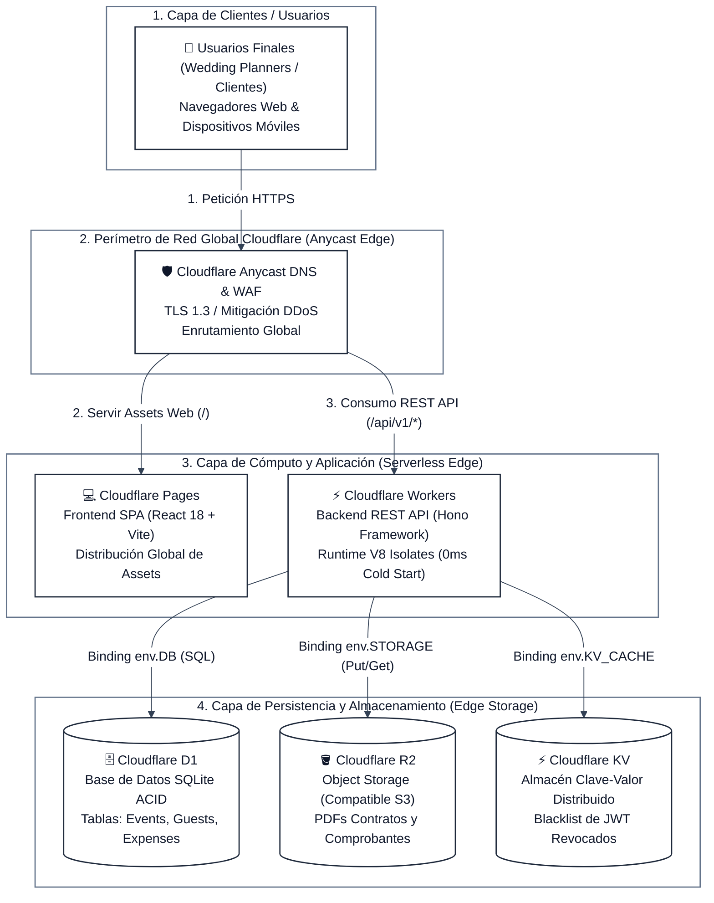

# Diagrama y Especificación de Infraestructura Cloud — Planora

**Proveedor Cloud Principal:** Cloudflare  
**Herramienta de Aprovisionamiento e IaC:** Wrangler CLI (`wrangler.toml`)  
**Modelo de Red:** Global Anycast Edge Network con terminación TLS automática  

---

## 1. Diagrama de Infraestructura Cloud en Producción (Cloudflare Native)



---

## 2. Diagrama del Ciclo de Vida DevOps y Despliegue Continuo (CI/CD)

```mermaid
%%{init: {
  'theme': 'base',
  'themeVariables': {
    'primaryColor': '#ffffff',
    'primaryBorderColor': '#1e293b',
    'primaryTextColor': '#0f172a',
    'lineColor': '#334155',
    'secondaryColor': '#ffffff',
    'tertiaryColor': '#ffffff',
    'mainBkg': '#ffffff',
    'nodeBorder': '#1e293b',
    'nodeTextColor': '#0f172a',
    'clusterBkg': '#ffffff',
    'clusterBorder': '#64748b',
    'clusterTextColor': '#0f172a',
    'titleColor': '#0f172a',
    'edgeLabelBackground': '#ffffff'
  }
}}%%
flowchart LR
    %% ETAPA 1: DESARROLLO
    subgraph DEV["1. Desarrollo Local"]
        DevStation["💻 Estación de Trabajo\n(VS Code / TypeScript)"]
        GitRepo["📦 Git Local\n(Conventional Commits)"]
        DockerEnv["🐳 Docker Compose\n(Entorno Hermético)"]
        DevStation --> GitRepo
        DevStation --> DockerEnv
    end

    %% ETAPA 2: CI EN GITHUB ACTIONS
    subgraph CICD["2. CI/CD (GitHub Actions)"]
        GitHub["🐙 GitHub Repo\n(Ramas: main / develop)"]
        TestStage["🧪 Vitest Tests & Lint\n(Cobertura >= 85%)"]
        DockerStage["🐳 Docker Build\n(Multi-Stage Alpine)"]
        GitHub --> TestStage --> DockerStage
    end

    %% ETAPA 3: REGISTRO DOCKER HUB
    subgraph REGISTRY["3. Registro OCI"]
        DockerHub[("📦 Docker Hub\nfrederickz/planora-api\nfrederickz/planora-web")]
    end

    %% ETAPA 4: DESPLIEGUE CLOUDFLARE
    subgraph DEPLOY["4. Despliegue Producción"]
        WranglerCLI["🚀 Wrangler CLI\n(IaC Automatizado)"]
        CloudflareEdge["🌐 Cloudflare Live\n(Workers API + Pages UI)"]
        WranglerCLI --> CloudflareEdge
    end

    %% Conexiones entre etapas
    GitRepo -->|"git push"| GitHub
    DockerStage -->|"docker push"| DockerHub
    DockerStage -->|"Dispara Despliegue"| WranglerCLI

    %% Estilos de Nodos en Color Blanco Puro
    classDef whiteNode fill:#ffffff,stroke:#1e293b,stroke-width:1.5px,color:#0f172a;
    class DevStation,GitRepo,DockerEnv,GitHub,TestStage,DockerStage,DockerHub,WranglerCLI,CloudflareEdge whiteNode;

    style DEV fill:#ffffff,stroke:#64748b,stroke-width:1.5px,color:#0f172a
    style CICD fill:#ffffff,stroke:#64748b,stroke-width:1.5px,color:#0f172a
    style REGISTRY fill:#ffffff,stroke:#64748b,stroke-width:1.5px,color:#0f172a
    style DEPLOY fill:#ffffff,stroke:#64748b,stroke-width:1.5px,color:#0f172a
```



---

## 3. Inventario de Recursos Cloudflare

Los recursos de cada ambiente se crean con **Terraform** desde el repositorio [GestionEventos-infra](https://github.com/Federico2003/GestionEventos-infra) (HCP Terraform, flujo VCS) y los pipelines despliegan el código sobre ellos.

| Recurso | Dev | Prod | Creado por |
|---|---|---|---|
| Cloudflare Pages (frontend) | `planora-web-dev` → `planora-web-dev.pages.dev` | `planora-web` → `planora-web-31d.pages.dev` | Terraform (`modules/pages`) |
| Cloudflare Worker (API) | `planora-api-dev.federico-zaragoza.workers.dev` | `planora-api-prod.federico-zaragoza.workers.dev` | Terraform (`modules/worker`) + `wrangler deploy` |
| Cloudflare D1 | `planora-d1-dev` | `planora-d1-prod` | Terraform (`modules/d1`) + migraciones de Drizzle |
| Rate Limiting de Workers | `AUTH_RATE_LIMITER` (10 peticiones / 10 s por IP) | `AUTH_RATE_LIMITER` | `wrangler.toml` |
| Cloudflare R2 / KV | Opcionales (sin binding la API usa adaptadores en memoria) | Opcionales | `wrangler.toml` (comentados) |

### Pages (frontend)
Hospeda la SPA de React compilada por Vite. Se despliega con `wrangler pages deploy packages/frontend/dist`.

### Worker (API)
Ejecuta la API de Hono. Recibe los bindings `DB` (D1) y `AUTH_RATE_LIMITER`, y los secretos `JWT_SECRET`, `SENTRY_DSN` y `ALLOWED_ORIGINS`. `GET /api/v1/health` reporta el ambiente, el estado de Sentry y la conexión con D1.

### D1 (base de datos)
Esquema de 11 tablas definido con Drizzle ORM (`packages/api/src/infrastructure/db/schema.ts`). El pipeline aplica `migrations/` con `wrangler d1 migrations apply DB --remote` antes de cada deploy. Limitación conocida: la API conserva los datos de negocio en un almacén en memoria con datos de ejemplo; D1 contiene el esquema y se verifica en el healthcheck.

### Rate Limiting de autenticación
El binding `ratelimits` limita `/api/v1/auth/*` a 10 peticiones en 10 s por IP y responde **429** con `Retry-After: 10`. Se usa el limitador nativo de Workers porque las reglas de rate limiting del WAF solo aplican a zonas con dominio propio (no a `*.workers.dev`), y KV no es adecuado para contadores por su consistencia eventual.

---

## 4. Configuración del Worker (`packages/api/wrangler.toml`)

```toml
# Configuración declarativa para Cloudflare Workers (Planora Backend API)
# Las bases D1 (planora-d1-dev / planora-d1-prod) las crea Terraform (repo GestionEventos-infra).
# El pipeline reemplaza __D1_DATABASE_ID__ con la variable D1_DATABASE_ID del environment de GitHub.
# R2 y KV son opcionales: sin binding, la API usa adaptadores en memoria.

name = "planora-api"
main = "src/index.ts"
compatibility_date = "2024-09-23"
compatibility_flags = ["nodejs_compat"]

[observability]
enabled = true
head_sampling_rate = 1.0

# ------------------------------------------------------------------------------
# Ambiente Dev (rama `develop`)
# ------------------------------------------------------------------------------
[env.dev]
name = "planora-api-dev"
workers_dev = true

[env.dev.vars]
ENVIRONMENT = "development"
NODE_ENV = "development"
API_VERSION = "v1"
SENTRY_TRACES_SAMPLE_RATE = "1.0"

# Rate limiting de autenticación: 10 peticiones / 10 s por IP (responde 429)
[[env.dev.ratelimits]]
name = "AUTH_RATE_LIMITER"
namespace_id = "1001"
simple = { limit = 10, period = 10 }

[[env.dev.d1_databases]]
binding = "DB"
database_name = "planora-d1-dev"
database_id = "__D1_DATABASE_ID__"
migrations_dir = "migrations"

# Opcional: descomentar tras crear los recursos en Cloudflare
# [[env.dev.r2_buckets]]
# binding = "STORAGE"
# bucket_name = "planora-assets-dev"
#
# [[env.dev.kv_namespaces]]
# binding = "KV_CACHE"
# id = "<KV_DEV_ID>"

# ------------------------------------------------------------------------------
# Ambiente Prod (rama `main`)
# ------------------------------------------------------------------------------
[env.production]
name = "planora-api-prod"
workers_dev = true

[env.production.vars]
ENVIRONMENT = "production"
NODE_ENV = "production"
API_VERSION = "v1"
SENTRY_TRACES_SAMPLE_RATE = "0.2"

# Rate limiting de autenticación: 10 peticiones / 10 s por IP (responde 429)
[[env.production.ratelimits]]
name = "AUTH_RATE_LIMITER"
namespace_id = "1002"
simple = { limit = 10, period = 10 }

[[env.production.d1_databases]]
binding = "DB"
database_name = "planora-d1-prod"
database_id = "__D1_DATABASE_ID__"
migrations_dir = "migrations"

# Opcional: descomentar tras crear los recursos en Cloudflare
# [[env.production.r2_buckets]]
# binding = "STORAGE"
# bucket_name = "planora-assets-prod"
#
# [[env.production.kv_namespaces]]
# binding = "KV_CACHE"
# id = "<KV_PROD_ID>"
```
